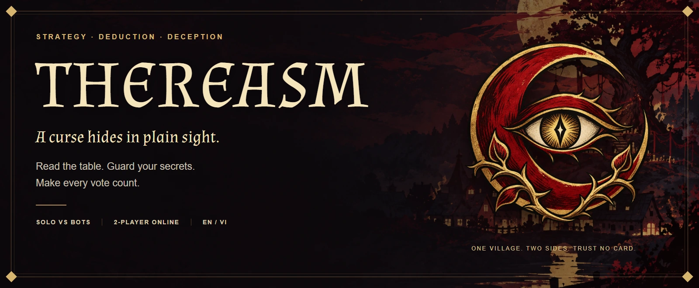
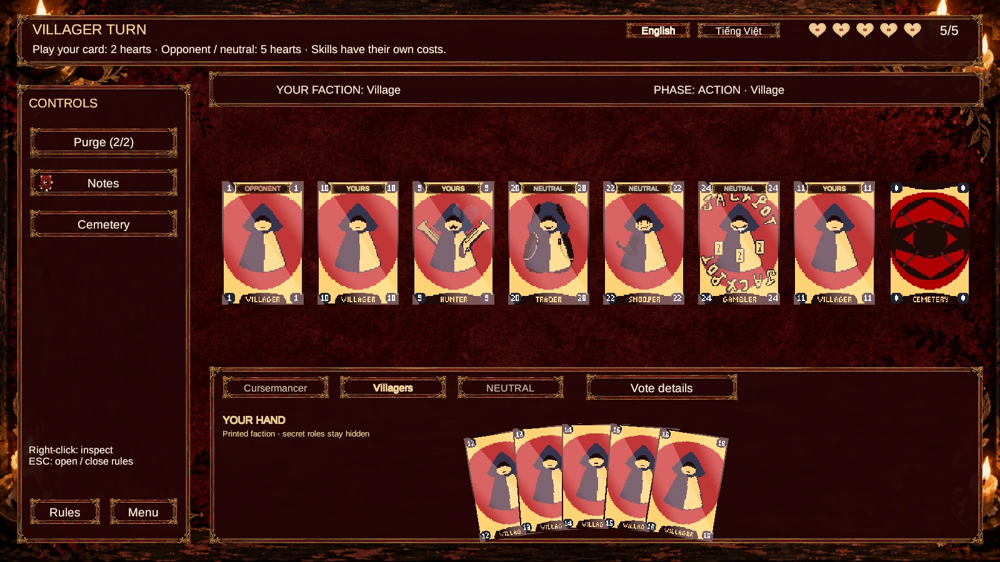
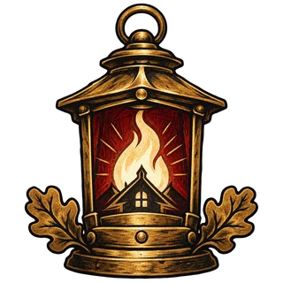
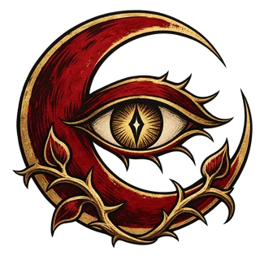
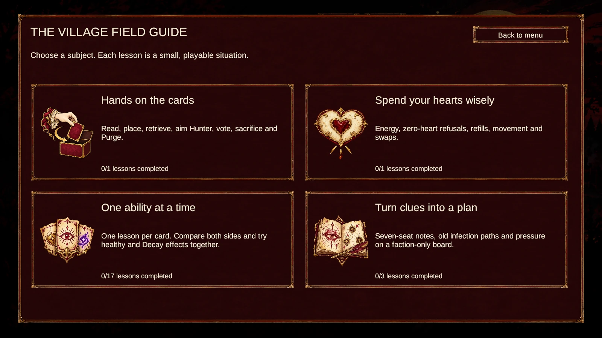
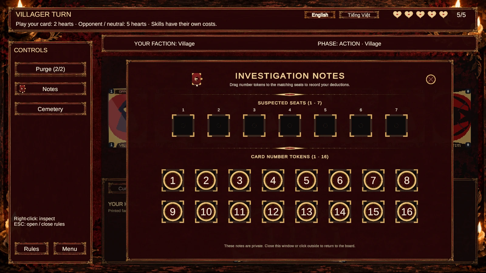
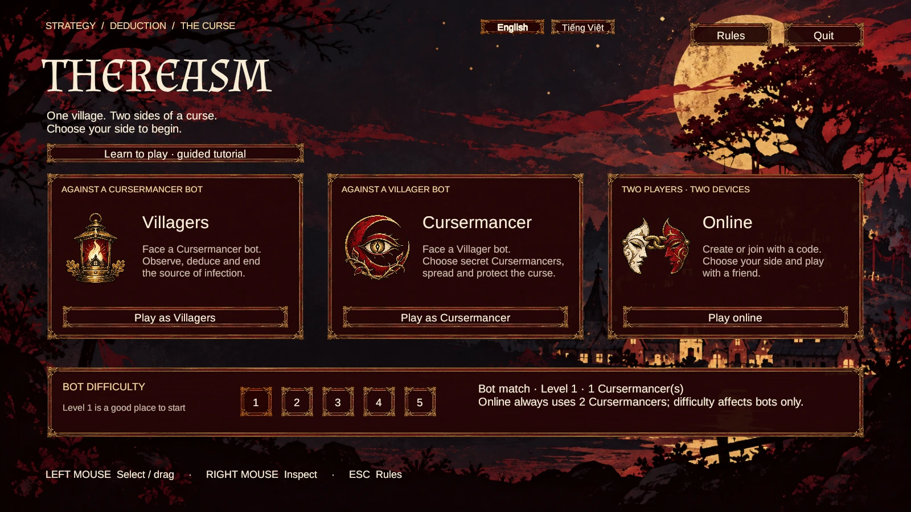

  

  <strong>Two players. One table. A lot to hide.</strong> 
  A duel of hidden curses, shifting votes and choices you cannot take back.

  <a href="#at-the-table">See the game</a> ·
  <a href="#choose-your-side">Choose your side</a> ·
  <a href="#get-started">Get started</a>

## At the table

- **Energy management:** Balance heart spending between deploying cards, moving pieces, and activating skills.
- **Neutral influence:** Use neutral cards for deduction, vote tampering, and tactical combinations.
- **Asymmetric deduction:** The Cursermancer tracks active curses; the Village must deduce them from observable actions and vote tallies.
- **Dynamic voting:** Skill interactions can swing ballots before the sacrifice verdict is sealed.

## Choose your side

The cards are on the table. The truth is not.

**Thereasm** is a strategy and deduction card game for two opposing players. One spreads the curse. The other follows its traces. Both can use neutral cards to turn a promising plan into a terrible mistake.

<table>
  <tr>
    <td width="50%" align="center">
       
      <h3>Village</h3>
      Read the clues. Remember who moved where. 
      Find the hidden Cursermancers before the curse takes hold.
    </td>
    <td width="50%" align="center">
       
      <h3>Cursermancer</h3>
      Plant the curse. Leave a convincing distraction. 
      Make the Village trust the wrong card.
    </td>
  </tr>
</table>

**Take either side against a bot, or challenge a friend online.** English and Vietnamese are available in-game; new installations start in English.

## Learn by playing

Start with a guided encounter, then explore controls, energy, individual abilities and deduction in short playable lessons. Keep your own suspicions in the investigation notebook.

<strong>A look at the main menu</strong>

## Get started

This repository contains the **Unity project**. A packaged game download is not currently included.

<strong>Open the project in Unity</strong>

1. Install **Unity 6000.0.29f1** with Windows Build Support.
2. Clone this repository and add its root folder in Unity Hub. Let Unity restore its packages and import the assets.
3. Download **Photon Fusion 2.0.13** from the [official SDK page](https://doc.photonengine.com/fusion/v2/getting-started/sdk-download), then import the `.unitypackage` via **Assets → Import Package → Custom Package**. Keep the project's saved `PhotonAppSettings.asset` and `NetworkProjectConfig.fusion` when selecting files. Initial missing-Fusion compile messages resolve after installation.
4. Wait for compilation. Run **Tools → Thereasm → Check Photon Fusion Setup**, then **Apply Saved Photon Settings**.
5. Open **`Assets/Scenes/MenuScenes.unity`** and press **Play**. New to the game? Take the guided introduction first.

The main scenes are `MenuScenes`, `MainBoard` and `TutorialBoard`. Scenes, prefabs, artwork and `.meta` files are included for editing in the Inspector.

<strong>Play online with a friend</strong>

Use matching builds, app versions and regions. One player creates a room; the other enters its code. Choose your factions in the lobby and start the match.

Connection settings live in `Assets/Networking/PhotonOnlineConfig.asset`. For your own deployment, enter your Fusion App ID there and run **Tools → Thereasm → Apply Saved Photon Settings**.

The game adapter and saved network settings are included. Photon Fusion's third-party SDK is installed separately from its official distribution.

<strong>Controls</strong>

- **Left mouse:** select, move and place cards; drag to vote during Sacrifice.
- **Right click:** inspect a card. **Right-drag:** aim a targeted ability.
- **Mouse wheel over the board:** zoom. Drag empty space or use the middle mouse button to pan. **Home:** restore the overview.
- **Esc:** open or close the rules/pause panel.

<strong>Builds, tests and project notes</strong>

Build the three enabled scenes for Windows from Unity's Build Profiles, or use **Thereasm → Build** for the compact English/Vietnamese builds.

Validation sources live in `Tests/Unity`; the two-player Photon probe is in `Tests/Players/OnlineMatchProbe.cs`. The PowerShell helpers under `Tools` use an isolated validation project so the active Editor is not driven or closed.

- [Photon setup and online implementation](Docs/PHOTON_ONLINE.md)
- [Card skill rules](Docs/CARD_SKILL_RULES.md)
- [Tutorial academy](Docs/TUTORIAL_ACADEMY.md)

---

<strong>The curse is already at the table.</strong> Which side will you take?

Third-party assets (Photon Fusion, Unity packages, fonts) retain their respective licenses and notices.
